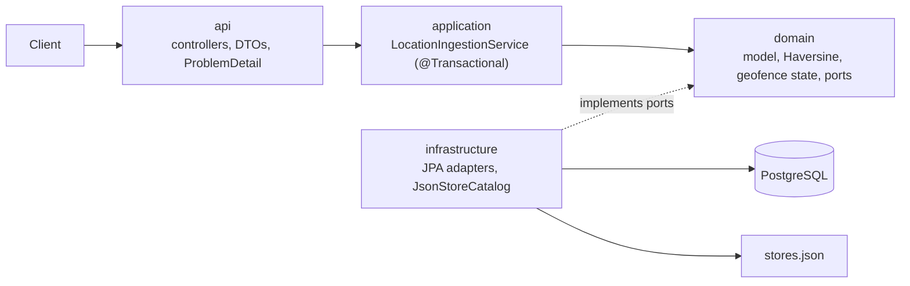

# Courier Tracking API

Spring Boot service that ingests courier GPS points, accumulates each courier's travel distance, and records an entrance event when a courier enters a store's 100 m radius.

## Prerequisites

| Tool | Needed for |
|------|------------|
| JDK 21 | Running the app and tests on the host |
| Docker (Compose v2) | PostgreSQL, all-in-Docker run, and Testcontainers |
| Maven Wrapper | Committed in the repo (`./mvnw` / `.\mvnw.cmd`) — no system Maven |
| `curl` + `bash` | Optional: `scripts/smoke-test.sh` |
| Postman (optional) | Import `postman/` and run the Walkthrough folder |

Ports `8080` (API) and `5432` (PostgreSQL) must be free.

```bash
git clone https://github.com/hikmet-cakir/courier-tracking.git
cd courier-tracking
chmod +x mvnw    # macOS/Linux, once
```

No extra config is required locally: `application.yml` matches `docker-compose.yml` (`courier` / `courier` / database `courier`).

| Property | Environment variable | Default |
|----------|----------------------|---------|
| `spring.datasource.url` | `SPRING_DATASOURCE_URL` | `jdbc:postgresql://localhost:5432/courier` |
| `spring.datasource.username` | `SPRING_DATASOURCE_USERNAME` | `courier` |
| `spring.datasource.password` | `SPRING_DATASOURCE_PASSWORD` | `courier` |
| `courier.stores.location` | `COURIER_STORES_LOCATION` | `classpath:stores.json` |

Schema is created by Flyway (`V1__init.sql`); Hibernate only validates it. Stores are loaded from `src/main/resources/stores.json` (`name`, `lat`, `lng`). Point `courier.stores.location` at another file (for example `file:/path/stores.json`) to use a different list.

## How to run

**Option A — Postgres in Docker, app on the host** (needs JDK 21)

```bash
docker compose up -d postgres
./mvnw spring-boot:run          # Windows: .\mvnw.cmd spring-boot:run
```

`.\mvnw.cmd` alone is not enough; it must be followed by a goal (`spring-boot:run`, `test`, …).

**Option B — everything in Docker** (no host Maven / JDK)

```bash
docker compose up --build
```

API: `http://localhost:8080`

```bash
curl -s http://localhost:8080/api/v1/stores
```

Expected: HTTP 200 and the five stores from `stores.json`. On Windows PowerShell use `curl.exe` instead of `curl`.

```bash
docker compose down        # keep database data
docker compose down -v     # also delete database data
```

Stop the host app (Option A) with `Ctrl+C`.

## How to test

### Automated (Maven)

```bash
./mvnw test                          # unit + integration (Docker must be running)
./mvnw test -Dtest='*Test'           # unit and @WebMvcTest only (no Docker)
./mvnw clean verify                  # clean build + all tests
```

Windows: `.\mvnw.cmd test` / `.\mvnw.cmd clean verify`.

`./mvnw test` does **not** need Compose or a running app. Integration tests start their own PostgreSQL 16 via Testcontainers. Expected: `BUILD SUCCESS`.

| Type | What it covers | Docker |
|------|----------------|--------|
| Unit | Haversine, geofence / cooldown, distance accumulation, ingestion with in-memory fakes | No |
| `@WebMvcTest` | Status codes, validation, malformed JSON, bad timestamps | No |
| `*IT` | Persistence, duplicates, rollback, concurrent POSTs, context startup | Yes |

### Smoke script (running app)

```bash
bash scripts/smoke-test.sh                       # default http://localhost:8080
bash scripts/smoke-test.sh http://host:port
```

Uses a new courier id each run, so it is safe to repeat against the same database. On Windows run it from Git Bash or WSL.

### Postman (easiest on Windows)

1. Import `postman/Courier-Tracking.postman_collection.json`
2. Import `postman/local.postman_environment.json` and select **Courier Tracking - Local** (top-right)
3. Open the **Walkthrough** folder and send requests **top to bottom**

Expected HTTP status is in each request name (`201`, `200`, `409`, `404`, `400`). Change `courierId` in the environment if you already used `walk1`.

Alternatively open `http/courier-tracking.http` in VS Code / Cursor (REST Client) or IntelliJ and click **Send** on each request.

### Manual requests (`curl`)

Ataşehir MMM Migros is at `40.9923307, 29.1244229`. Store `id` is a UUID v3 derived from the name (`7149e322-5c08-3471-942d-311309121d39`).

```bash
# 1. First point inside the store -> 201, applied=true, one entrance event
curl -s -i -X POST http://localhost:8080/api/v1/locations \
  -H "Content-Type: application/json" \
  -d '{"courierId":"c1","timestamp":"2024-01-01T00:01:00Z","latitude":40.9923307,"longitude":29.1244229}'

# 2. Same request again -> 200, no side effects
# 3. Earlier timestamp -> 201, applied=false
curl -s -i -X POST http://localhost:8080/api/v1/locations \
  -H "Content-Type: application/json" \
  -d '{"courierId":"c1","timestamp":"2024-01-01T00:00:00Z","latitude":41.0,"longitude":29.0}'

# 4. Total distance (404 if the courier was never ingested)
curl -s -i http://localhost:8080/api/v1/couriers/c1/distance

# 5. Entrance events (optional courierId / storeId filters)
curl -s "http://localhost:8080/api/v1/entrance-events?courierId=c1"
```

Expected body of request 1:

```json
{
  "applied": true,
  "totalDistanceMeters": 0.00,
  "entranceEvents": [
    {
      "courierId": "c1",
      "storeId": "7149e322-5c08-3471-942d-311309121d39",
      "occurredAt": "2024-01-01T00:01:00Z"
    }
  ]
}
```

Errors are RFC 7807 `ProblemDetail` (`400` validation / malformed JSON / bad timestamp, `409` same key with different coordinates, `404` unknown courier).

## API

Base path: `/api/v1`

| Method | Path | Description | Responses |
|--------|------|-------------|-----------|
| `POST` | `/locations` | Ingest a courier location | `201` created, `200` duplicate, `400` invalid, `409` conflict |
| `GET` | `/couriers/{courierId}/distance` | Total travelled distance in meters | `200`, `404` unknown courier |
| `GET` | `/entrance-events` | Events ordered by `occurredAt`. Optional: `courierId`, `storeId` | `200` |
| `GET` | `/stores` | Configured stores | `200` |

**`POST /locations` body:** `courierId` (not blank), `timestamp` (ISO-8601 instant), `latitude` (−90..90), `longitude` (−180..180).

**Response shapes**

- Location: `{ applied, totalDistanceMeters, entranceEvents[] }`
- Distance: `{ courierId, totalDistanceMeters }`
- Entrance event: `{ courierId, storeId, occurredAt }`
- Store: `{ id, name, latitude, longitude }`
- Error: `{ title, status, detail, ... }`; validation adds `errors: [{ field, message }]`

## Architecture



Layered modular monolith: HTTP adapters in `api` map to DTOs only; `LocationIngestionService` is the single `@Transactional` boundary (lock-or-create, idempotency, out-of-order history, distance, geofence). `domain` is plain Java (no Spring, no JPA). `infrastructure` loads an immutable store catalog from `stores.json` and persists through JPA entities mapped to domain models. Durable state lives in PostgreSQL so a restart is safe; stores are configuration, not tables. Same-courier writes are serialized with `INSERT … ON CONFLICT DO NOTHING` then `SELECT … FOR UPDATE`.

```
com.example.courier
├── api                  controllers, DTO records, ProblemDetail advice
├── application          LocationIngestionService, result / conflict types
├── domain
│   ├── model            Location, Store, CourierTrack, EntranceEvent
│   ├── geo              DistanceCalculator, HaversineDistanceCalculator
│   ├── geofence         GeofenceState (Outside/Inside), GeofenceEvaluator
│   └── port             StoreCatalog + repository interfaces
└── infrastructure
    ├── store            stores.json loader
    └── persistence      JPA entities, Spring Data, adapters, mappers
```

## Design patterns

- **Strategy** (`DistanceCalculator`): Haversine is one algorithm behind an interface so tests can inject a fake and a future formula would not leak into the service.
- **State** (`GeofenceState.Outside` / `Inside`): entrance, stay, exit, and 60 s re-entry cooldown live on the state objects instead of a branching pile in `LocationIngestionService`.
- **Repository** (ports in `domain.port`, JPA adapters in `infrastructure`): persistence and locking stay behind interfaces the domain/application can call without Spring or SQL.

No other patterns were added.

## Assumptions

Interpretations of the agreed business rules (the simplest option consistent with the spec):

3. **Entrance / 100 m boundary.** A courier is inside a store iff Haversine distance `<= 100.0` m (inclusive). `99.9` and exactly `100.0` are inside; `100.1` is outside.

5. **Re-entry suppression.** Evaluated independently per `(courierId, storeId)`. An `EntranceEvent` is written only when `last_entrance_at` is null or `(recorded_at - last_entrance_at) >= 60 seconds`. If suppressed: no event, `last_entrance_at` is not advanced, but the pair still becomes `INSIDE`. Business time is always the courier-supplied `recorded_at`; `received_at` is an audit column set to server `Instant.now()` and is never used for distance, geofence, or cooldown.

6. **Initial state.** A missing `geofence_state` row means `OUTSIDE` with no previous entrance. Therefore the first *applied* location already inside a radius is an entrance.

8. **Out-of-order / non-advancing.** `recorded_at <= last_recorded_at` (equality included) is stored in `courier_location` with `applied=false` and does not change distance, geofence state, or events. Response is `201` with `applied=false`.

9. **Duplicates.** Natural idempotency key is `(courierId, timestamp)`. Same coordinates (`Double.compare` on the persisted doubles) → HTTP `200`, no writes. Response body uses the stored `applied` flag, the current track total, and entrance events for that courier whose `occurred_at` equals the timestamp. Different coordinates → HTTP `409`.

10. **Future timestamps.** No upper bound. The timestamp must parse as an ISO-8601 instant.

11. **Unknown courier.** `GET /couriers/{id}/distance` returns `404` when no `courier_track` row exists (the courier has never been ingested).

**60 s boundary.** Exactly 60.000 seconds is enough to emit (`recorded_at >= last_entrance_at + 60s`). 59 seconds is not.

**Store identity.** `stores.json` has no `id` field (only `name` / `lat` / `lng`). At load time a stable UUID v3 is derived from the store name (`UUID.nameUUIDFromBytes`). Renaming a store changes its identity. String columns are `VARCHAR(255)` so Hibernate `ddl-auto=validate` matches JPA defaults.

**Haversine.** Earth radius `6_371_008.8` m. Distances in API responses are rounded to 2 decimals (`HALF_UP`).

## Scaling

The current design is enough for one-node, courier-keyed row locks: same courier is serialized in Postgres, different couriers run in parallel. When ingest volume justifies it, publish an **outbox** row in the same transaction as the location write, drain it with a **message broker**, and **partition consumers by courierId** so each courier’s stream stays ordered. Do not introduce a broker, cache, or extra store until that load shows up.
